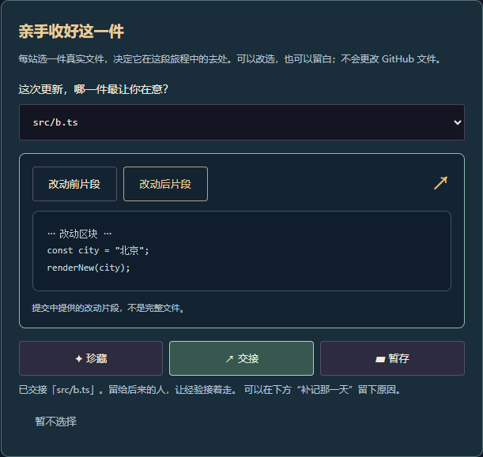
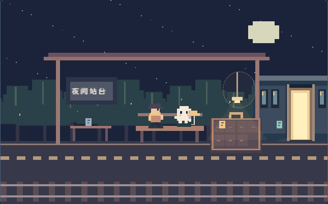

# 再走一小段 · 玩法与分镜

> 当前定位（2026-10-19）：本仓库继续维护七站推箱游戏。Kiro 的单站 45–60 秒方案只属于比赛准备资料，不是本仓库当前验收范围；Codex 改动不计作 Kiro 记录。

本轮用户明确要求分镜闯关，因此替换旧版固定 53 秒、单场景动画。保留像素配色、项目导入、可配置 API、亲手关灯和 PNG 导出。

## 当前主线：回看真实更新，再与项目告别（2026-10-16）

2026-10-17：玩家可以在已经走过、且有真实资料或本人补记的回忆页夹上一枚书签。最多选一页，可替换或取消，不自动代选。书签进入站台反馈、日记交接动画、纪念票和离线回忆册；结果页可以再翻这一页，修改选择后重新生成纪念图。重玩时保留选择，但重新走到对应关卡前不展示为本次已走过。换项目清空。

2026-10-17：站台上的行李可逐件点击。前五件优先使用能对应到该次提交所改文件的项目关键词，并以关键词生成物件色彩与标签；无可靠匹配时回退到真实提交标题。点击后，故事直接展开在站台，显示该页日记与来源；需要查看改动证据时可继续打开完整回忆。列车离站后的结果画面仍保留行李交互。

2026-10-17：用户关灯后，站台原画继续留在结果页。点击空处会出现短暂的像素水纹；点击已收好的物件会展开同一条项目故事并在箱中泛起金绿色波纹。完成态烟花停止，波纹约一秒后收束；减少动态效果时显示静止波纹。此反馈是可选视觉回响，不增加关卡或通关条件。

2026-10-19：关灯后的告别先让本次实际收好的旅途物件按走过顺序逐格回亮；字幕带出最后一件有资料依据的物件所收着的项目线索，没有依据时只报物件数量，不补造经历。随后再让项目伙伴的随身道具亮起。提前到站只回应真实收好的物件；减少动态直接进入终态。这个镜头把七站操作接回告别主线，不增加新的通关条件。

告别段落约 9 秒：项目伙伴先把带书签的日记交给玩家，让随项目类型变化的道具最后亮一次，再走向列车、登车消失；镜头先从全景缓缓靠近至 1.48 倍，再平滑拉远；列车驶出后，圆满收尾以烟花庆祝，暂时休息留一扇暖窗，交接以接力灯火回应，暂不定义则保留安静星空。未选择书签时不出现交书动作。减少动态直接呈现终态。提前到站保留其真实状态，不声称走完整段旅程；站台之前的日记也不提前写“已经关灯”。

2026-10-20：伙伴登车时把项目道具留给玩家：道具从手边飞进行李，在行李上亮起后停留。对应的告别短句使用道具原有的项目专属收尾文案，让推箱收纳的旅程落到这件同行纪念上。

开场分为两幕：试玩页约 12.4 秒的事务所序章，登记项目后约 13.4 秒的专属启程镜头。后者只报实际选中的提交数量；没有 Git 时间线时明确留白，不编造项目历史。两幕均可跳过，减少动态时直接进入关键帧。

一次旅程只做三件事：陪项目回看几次真实变化、收好已经留下和还没完成的部分、送伙伴离开并亲手关灯。不再增加与项目无关的小游戏。

- 读取默认分支最近 40 条 GitHub 提交，按日期预选最多 5 条，允许改选。预选只覆盖时间范围，不宣称自动识别“重大成果”，也不将 commit 时间称作 push 时间或完整开发历史。
- 每条回忆保存 Git 提交日期（UTC）、完整 SHA、作者、提交正文中的共同署名，以及最多 3 个安全文件各 1,000 字的差异。引用真实仓库地址；不保留署名邮箱。接口依据 [GitHub 官方提交文档](https://docs.github.com/en/rest/commits/commits#get-a-commit)。
- 档案分析的同一次请求同时整理日记。每段解读只能引用对应 SHA 的文件差异；引用不匹配就丢弃。匹配引用不等于语义绝对正确，界面保留依据，并允许“只保留原始记录”。不能用当前 README 补造过去的实现、测试通过、上线或作者心情。
- 回忆以项目为叙述者：哪天、谁写下哪次提交；这次改动表达了什么行为变化。没有差异时只转述提交说明；没有 Git 历史时明示“资料回看”，不用比喻套话编造故事。个人经历只能通过“补记那一天”补充。
- 前五关的标题与行李对应所选更新和文件；第六站书库处理本人遗憾或资料记载的未完成事项，避免提交覆盖去留选择；第七站才正式告别。最多五次所选提交分别出现在前五关后的日记；最终页可回看选中的最后记录，不声称项目已经结束或完成。
- 新的蓝调日记场景通过翻页、文件条目渐显与两位角色同看一本书表达回忆；证据与技术差异折叠在正文下方。离线回忆册同时保存文字、改动片段、原始提交链接和本人补记。

## 玩法选择

| 方向 | 适配与成本判断 | 本轮决定 |
| --- | --- | --- |
| 森林冰火人式双角色平台跳跃 | 双角色协作适合陪伴，但跳跃物理、碰撞、移动端双人输入需要大量手感调校 | 借鉴角色互补，采用轮流操作 |
| 推箱子 | 规则清楚，离散状态易验证，撤销让尝试成本低；物件搬运符合携带项目成果的主题 | 主玩法，七个手工小关卡 |
| 切西瓜 | 即时反馈强，但连续切碎与保存项目的情绪不一致 | 不采用 |
| 无敌破坏王式动作破坏 | 戏剧性强，但破坏反馈、美术和关卡范围更大 | 不采用，亦不复制其形象 |

这是适配本项目的设计判断，不宣称这些产品使用相同实现。

## 参考如何落地

- [Patrick's Parabox 官方介绍](https://www.patricksparabox.com/)：每个谜题介绍一个新想法。这里依次教学推箱、幽灵过水开桥、组合机关搬运。
- [Unpacking 官方介绍](https://www.unpackinggame.com/)：通过物件了解角色，没有计时或得分压力。这里通过随身物件与拾取物件对应的实际项目细节建立联系，跳过不会标记为通关。
- [Celeste 官网](https://www.celestegame.com/)：关注精确的手工关卡体验。这里采用短动作、一步缓冲与即时重置，不直接复刻平台跳跃。
- [Pixar 与波士顿科学博物馆的动画制作说明](https://sciencebehindpixar.org/pipeline/animation)：关键姿势和姿势之间的运动共同表达角色。这里分别处理起步、步中轻跳、停步、幽灵悬浮、碰壁回弹与过关举手；减少动态效果保留完整规则。

## 项目与玩法的连接

这款游戏的立意是结束一段与项目的同行，并承认项目留下的东西。参考 [Spiritfarer](https://thunderlotusgames.com/games/spiritfarer/) 的告别由共同生活逐步建立，[How to Say Goodbye](https://store.steampowered.com/app/1709700/How_to_say_Goodbye/) 的解谜动作直接帮助角色继续前行，以及 [Unpacking](https://www.unpackinggame.com/) 通过物件与去留讲述人生。适合本项目的方向是“整理行李并送一位伙伴上路”，不是叠加更多小游戏。

- 保留轻量推箱与护送，但每个箱子都要对应已经确认的项目事实、完成项、提交记录或本人写下的遗憾；未说明时呈现空白，不用通用箱子假装内容相关。
- 让目的地表达实际选择：成果进入档案，未完事项由玩家决定收藏或带走。地图障碍应该表达共同推进的过程，不能只为增加难度。
- GitHub 提交是日记中的真实节点，不虚构项目例会、对白或项目成员经历。回忆展示提交原文、作者、日期和有依据的改动解读，个人经历由本人补记。
- 告别要发生在行动里：玩家送项目幽灵登上末班车；已选去留的项目片段留在书架或自己的行李中。离站画面不宣称项目已经完成，也不把暂停或结束包装成失败。

已选 GitHub 提交会成为一页页日记：翻页动画显示日期、作者、标题片段和改动文件，正文保留完整标题和证据入口。前五关的行李对应更新文件；书库保留本人遗憾或未完成事项的去留选择。末班站台里项目幽灵从长椅走向列车门，玩家与行李留在站台；PNG 纪念票和离线回忆册使用列车离站后的画面。

## 分镜

| 镜头 | 玩家动作 | 画面与反馈 | 完成条件 |
| --- | --- | --- | --- |
| 出发前 | 选样例或导入项目 | 关键词档案；来源与改写折叠；主观留言选填 | 确认出发 |
| 01 雨后小径 | 人推箱到金框；换幽灵同行 | 林地、路灯、随身道具、可选火花 | 箱到位、两人分别到出口 |
| 02 萤火渡口 | 幽灵过水踩机关，人过桥 | 水面流动、机关亮起、桥打开 | 人到出口锁住桥，幽灵跟上 |
| 03 旧日温室 | 你整理上下两件行李，幽灵点亮两盏灯 | 行李对应项目片段，灯亮后温室开花 | 两箱到位、两灯亮、两人到齐 |
| 04 屋顶微光 | 先把箱子搬到桥前，再绕到右侧推回金框 | 城市窗口、水渠与屋顶栏杆 | 箱到位、两人到齐 |
| 05 回声工坊 | 伙伴穿过水渠踩住机关；玩家推两件行李经过闸门，再与伙伴点亮两盏灯 | 两条搬运路线交叉，机关状态与灯光回应彼此协作 | 两箱归位、两灯亮、两人到齐 |
| 06 留白书库 | 将纪念页推上左侧书架，或经下桥运到右侧行李格 | 页上对应本人心意与确认资料；两种去处 | 任一目标到位、两人到齐 |
| 07 末班站台 | 幽灵守桥、点灯，人绕路收好行李 | 带走分支的纪念页继续随行 | 箱到位、两灯亮、两人到齐 |
| 每关之后 | 翻开回忆，选填自己的片段 | 返回有旧显示器与台灯的事务所；屏幕、稿纸、工具、空白页、信封与行李依次登场 | 手动继续，不限阅读时间 |
| 到站 | 亲手关吊灯 | 幽灵把书签页交给玩家，让项目道具最后亮起，再走向车门；列车离开，玩家与旅途物件留在站台 | 用户关灯并看完约 9 秒送别 |
| 纪念票 | 预览和主动下载；重看回忆册 | 大幅站台插画、名字、旅途印记与可选日期；回忆和档案放在页面里 | PNG 可打开 |

移动时长 160 ms，最多缓存下一步；移动中换人等待落定，撤销有返回插值。背景一次绘制缓存，角色与环境小动作逐帧绘制。后台暂停。键盘、44px 方向按钮、邻格点击、滑动均可操作；X 换人、Z 撤销。提示只给下一步，搜索分批让出主线程。走入死角可撤销或重开本关。

## 项目档案

用途 / 已经留下 / 资料中的待办 / 技术四类，API 每个词组带路径与原文引用。拒绝无法在材料中找到的引用。手动修改事实后，同类旧 API 词组不再采用。资料不足显示未说明，不由功能列表推算完成度。原文引用匹配仍需要人判断语义，不能替代运行验证。

## 明确边界

本轮是七个固定关卡，不生成无限地图；不做战斗、跳跃物理或联机。刷新清空本局、回忆与项目信息。提示搜索有 50,000 个状态上限，超限同样提示撤销或重来。美术与音效均为代码原创，无外部素材和新增运行依赖。

## 同行行李这一轮

七站收藏物依次是火花、叶片、钥匙、齿轮、信封、纪念页和车票，象征念头、成果、摸索、改动之间的连接、留言、心意和这段同行；不把象征物当作真实经历。物件飞入四列两行的旅途箱，后面的场景和最后的纪念画面继续带着它们。

同行行李是一排七个物件按钮。走完一站便能打开那段回忆；未拾取也可以回看，空格不代表失败。途中回看保留棋盘、撤销记录与当前关卡；到站后点击物件会在站台原画面展开对应故事，并高亮箱中物件，完整提交证据仍可从日记打开。离站后的结果画面继续允许翻看。个人片段仍是自愿填写。

这排按钮同时承担旅程路线：前五格在游戏途中显示真实提交日期，到站后显示匹配项目关键词或提交主题；第六格是未完成内容的去处，第七格才是告别。关键词仅在其引用来源对应提交改动文件或文本可在该次改动中核实时采用，否则退回提交标题；不把无关项目标签硬配到某次更新。当前站、已走过、收集物、选中物件和书签都有不同状态；第五条之后的提交仍可留在项目档案中，但不会冒充已经走过的游戏回忆。

回忆册可单独下载为离线 HTML：图画开场、可折叠的回忆与资料，不请求外部资源。明确保留已核对的资料与用户自己的留言；重玩尚未走到的旧留言不冒充本次旅途。页面刷新依旧清空进度，已下载的回忆册保留。
## 项目内容进入行动

每站操作区只露出一个有来源的项目片段，完整内容与来源可以展开。用途作为出发的念头，已有成果对应要收好的行李，书库纪念页对应本人留言，或随心意选择采用已确认的成果、待办。用户可写收获、回忆或惦念，API 不代写；没有材料时不编造。

留白书库在同一地图提供两条可解路线：把纪念页推到书架，表示先收藏；把它绕桥运到右侧行李格，表示带向下一站。两者都满足通关，没有好坏结局评分。带走的页会继续出现在站台行李旁；收藏的页留在书库。结果文案和离线回忆册记住玩家的选择，但不把它解释为真实项目的完成、删除或重新启动。撤销或重开书库会清除待定选择，重新通关后再记录。

重做恢复完整棋盘快照，移动或换人产生新分支时清空。设置使用原生对话框，自动暂停和恢复原场景；从已暂停状态打开则继续保持暂停。落脚提示只展示规则允许的相邻格，减少动态仍能使用全部功能。固定墙角的箱子提示可撤销，不直接宣布游戏失败。

## 点灯与下一小步

这轮加强同伴的主动作用：温室和站台各有两个灯芯，只有幽灵走过才会亮。点亮会留下温暖的光与温室花朵；人物负责搬运，幽灵负责照亮。灯与箱子都使用完整快照，撤销不会遗留错误的奖励状态。短促光点独立于移动插值，连续走路不会截断上一件行李的归位反馈。

编号行李标签对应同编号箱子，可点击定位，来源收在「项目原文」。项目关键词不够时留出未命名片段，不制造新的成果。归位与点灯的短反馈带入已确认的内容，明确它们仍是旅途里的象征。

在书库选了带走的人，到终点后可写「带给下一程的一句话」。旁边带出纪念页作为上下文；便签可以是收获、祝福或想做的小事，完全由用户填写，60 字以内，可留空。它保存在本次回忆册中，不成为催促继续项目的任务。收藏分支没有这项填写要求，重玩重置便签。纪念图继续保持简洁。

站台等待不再停住画面，保留幽灵起伏、萤火和灯光；打开设置、进入后台或选择减少动态时停止 RAF，关灯前清理旧循环。桌面操作区将换人与方向键并排，原文默认折叠，地图仍是视觉主体。

## 陪伴多年之后的送别

出发前可选择圆满收尾、暂时休息、交给后来的人，默认暂不定义。选择代表使用者这次同行的心意，不是对代码完成度的鉴定，不改写原始资料。书库优先收下本人留言；选择收尾、休息、交接而未留言时采用确认过的成果，缺少资料仍留白。书库标题、行李内容、告别字幕、关灯按钮与纪念票、离线回忆册使用同一份选择。

到站后仍可改主意，棋盘、进度、留言、便签和书签不重置；页面不催促关灯。带走纪念页可以只是带走收获，便签也可以是祝福。内存中的选择与回忆仍需主动下载保存。

验证：57 项自动化用例覆盖来源、未知枚举、心意切换与缺失资料留白。`tests/play-settings.mjs` 实走七站，检查收获成为纪念页、书签和行李，站台四种心意切换保留进度，并实际下载回忆册；同时覆盖 320–1280 px 布局与 44 px 操作区。`tests/browser.mjs` 保留默认路线、正常动画、收藏分支与导出回归。

## 项目原件、城市体验与页面稳定性

出发前拆成原件、心意、目的地三个视图，结束后拆成纪念票、回忆册、原件三个视图。设置继续通过对话框展开，城市工作台默认折叠，天气项目点击首站行李标签可展开。原件使用所选材料的原文，不运行 HTML 或代码；图片限 4 张、每张 5 MB，解码后缩到最长边 1200 像素并转为 PNG。图片不提交 API，只有主动下载回忆册时随文件保存。

城市输入把天气项目的功能词变成可玩的操作。北京/Beijing 与纽约/New York/NYC 分别对应灯笼屋檐、都市楼群；瑞雪、圣诞、万圣节由玩家选择，不作为实时天气或自动节日判断。未知城市显示通用夜景提示。换城仅改变场景，棋盘、历史和回忆不重置；地图边缘的城市灯语彩蛋解锁同行灯，显示两名角色各自规则允许的邻格，不自动移动或绕过机关。

移除 ResizeObserver 测量父宽再写子宽的反馈路径，画布由 CSS 固定比例约束；HUD 与舞台放入同一容器，避免侧栏高度改变地图上方留白；告别字幕预留固定高度，动画只改变画布内部镜头。浏览器用例在 320、390、980、1280 px 连续 45 帧记录画布边界和滚动位置，验证没有往返跳动。

本轮验证：59 项单元与服务测试、生产构建、原有两套七站浏览器流程，以及新增 experience 流程（原件/图片失败恢复、换城、彩蛋、布局、9 秒告别与实际导出）。尚未做真实手机或微信内置浏览器验收。

### 2026-10-20 · 告别由心意决定

四种心意对应不同结尾。关灯时吊灯渐暗，伙伴登车后列车完整驶出；找到的同行灯在站台留下引路微光。纪念票与回忆册使用同一幅静态结尾，不把休息或犹豫一律演成庆祝。

站台可写 120 字短信，也可从出发前的个人心意带入。输入超限时保留草稿并提示，不允许静默截断；改换心意也不清空草稿。短信折成信封留在行李上，原文完整写入纪念票和回忆册，提前到站同样保留，不计作关卡回忆或完成度。

“重看告别”复用当前旅程，只重播最后一幕；“收好这一幕”立即展示纪念。两者都保留七站进度、便签、书签、城市和短信。减动模式直接显示静态结尾，播放中启用减动也立即收束。

验证：60 项单元与服务测试、生产构建、七站 play-settings 流程、扩展后的 experience 流程通过；覆盖四种结尾、超长短信草稿保留、HTML 转义、实际图片与回忆册下载、重播与中途减动。未进行手机真机验收。

### 2026-10-20 · 仓库成为可整理的项目遗物

当前连接的缺口：提交已经成为剧情文本，但玩家对它的回应多是阅读和写留言；只读最近 40 条也容易把多年项目压缩成最近一段。本轮将交互接成“找回旧更新 → 回看真实文件 → 亲手决定去处 → 带着选择告别 → 导出可用的交接单”。

参考与取舍：

| 官方参考 | 本项目的设计判断与落地 |
| --- | --- |
| [Unpacking](https://www.unpackinggame.com/) 通过拆箱、摆放物件了解一段人生，没有计时或评分压力 | 每站从真实文件中选一件，珍藏、交接或暂存；可改选、撤回或留白，不用额外分数评价告别 |
| [Spiritfarer](https://thunderlotusgames.com/games/spiritfarer/) 通过相处、照顾与共同经历建立关系，再完成送别 | 回看并整理项目文件发生在告别前；物件最终去向进入站台动画。沿用本项目角色、美术与七站规则 |
| [GitHub Activity](https://docs.github.com/en/repositories/viewing-activity-and-data-for-your-repository/using-the-activity-view-to-see-changes-to-a-repository) 将仓库活动关联到真实提交与用户 | 保留 SHA、日期与原始提交链接，区分 Git 提交时间、个人补记、游戏象征；不把提交时间叫推送时间 |
| [GitHub Commits API](https://docs.github.com/en/rest/commits/commits#list-commits) 提供截止时间查询 | 用户选定 UTC 截止日，读取默认分支该日前最近 40 条；保留跨年份已选项，最多选五次，不宣称完整历史 |

遗物整理台与故事分为两个页面。改动前后视图来自已取得的 patch，明确标为片段，不能当作整个文件或可运行的旧版本。没有差异或不安全路径时不补造代码；手动原件只显示原文。每站一件，最多五件，沿用已有个人补记；这些选择不改变谜题规则，也不会创建、关闭或修改 GitHub 文件、Issue、PR。

珍藏物件留在行李中；交接物件随列车离开；暂存物件留在站台书架。结果页的遗物集合可返回对应日记改选，之后纪念图重新生成。回忆册与 Markdown 交接单保存真实来源和个人补记。换项目清空选择，重走旅程只展示本次重新访问过的页，不把旧选择冒充本次进度。

范围：每次查询最多 40 条、每条最多 3 个安全文件与 1,000 字 patch；缺失的差异留白。不自动拉取或运行任意项目，也未接入 Issue/PR 的写入操作。

验证：65 项单元/服务测试、生产构建、新增遗物端到端流程和 GitHub 日记七站流程通过。另用本项目真实仓库调用截止 2026-10-18 的查询，取得 5 条提交，返回时间均符合截止日。浏览器覆盖 320/390 px；尚未进行手机真机或微信验收。

以下为本地固定样例的整理台与站台效果，不是用户私人项目内容：

