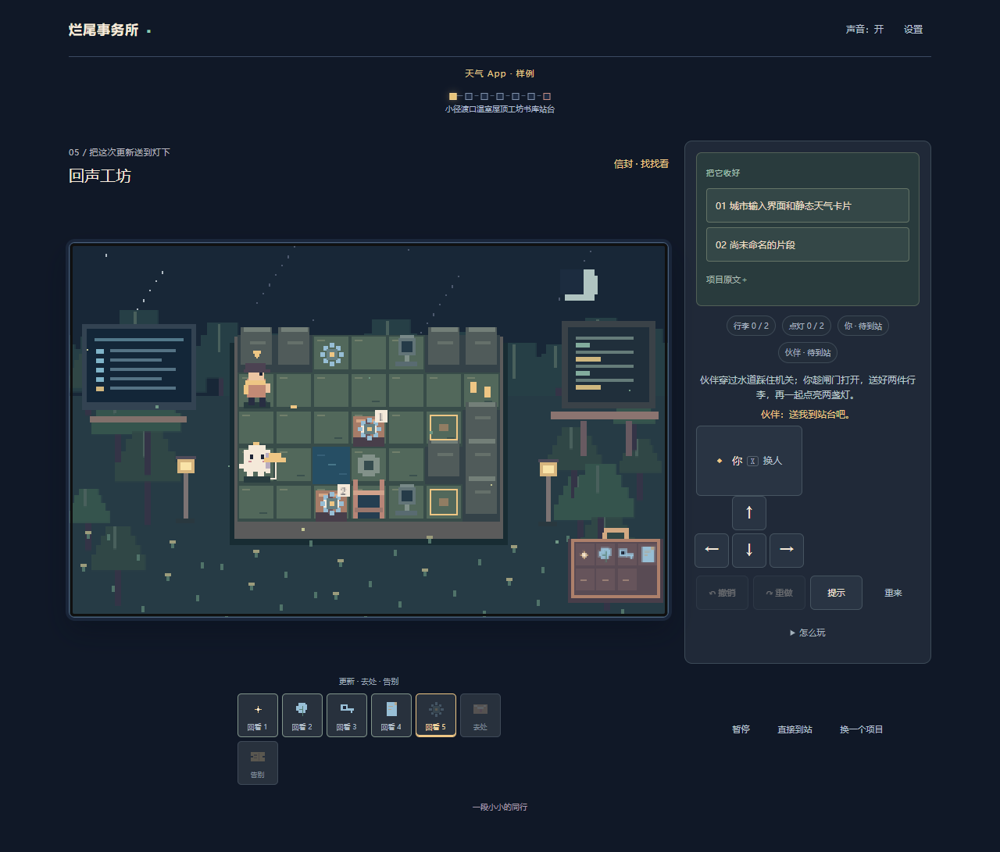
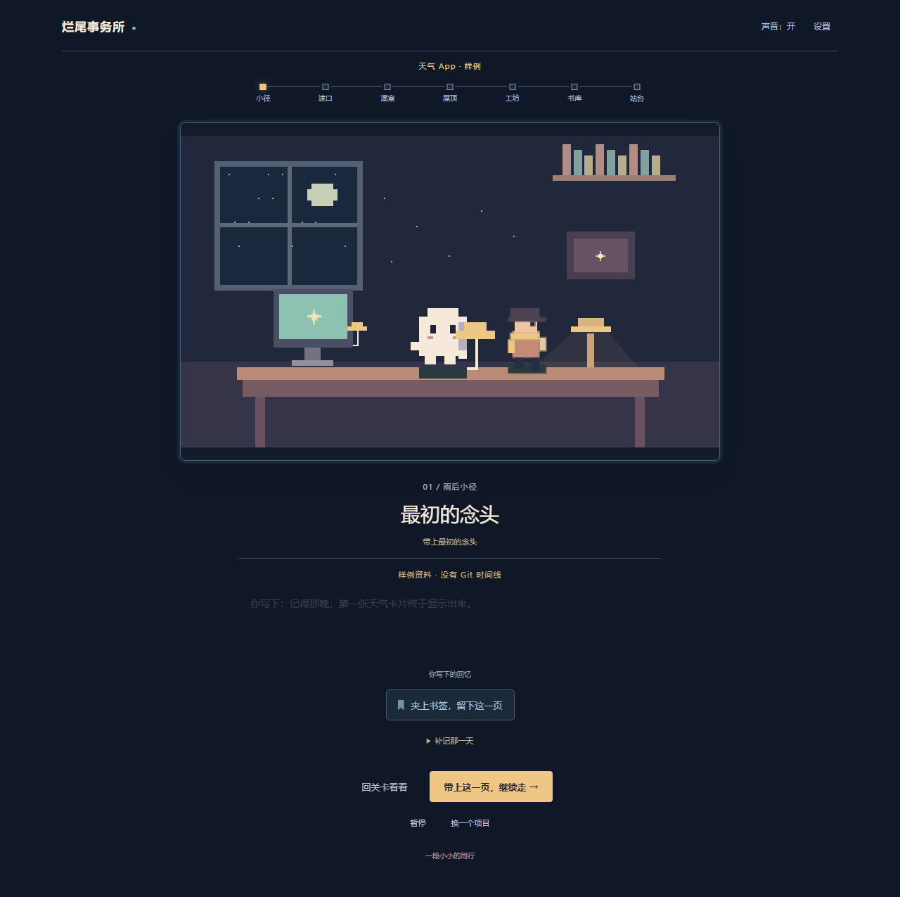
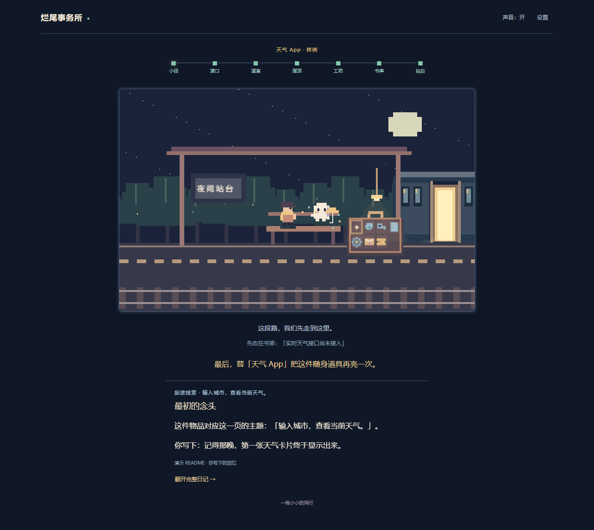
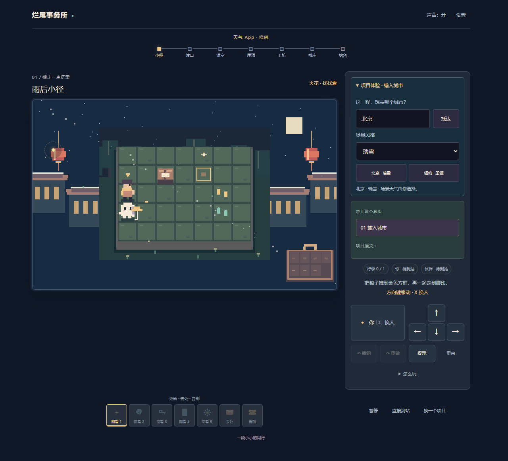
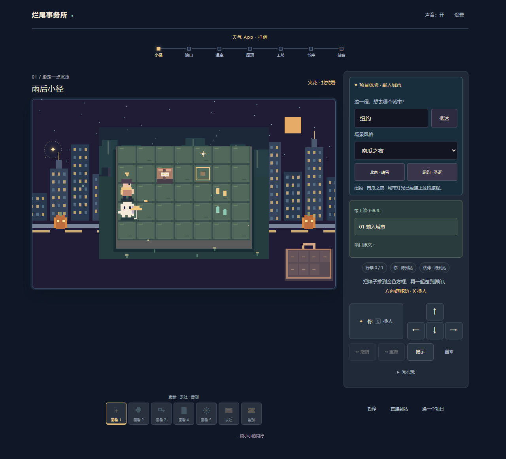
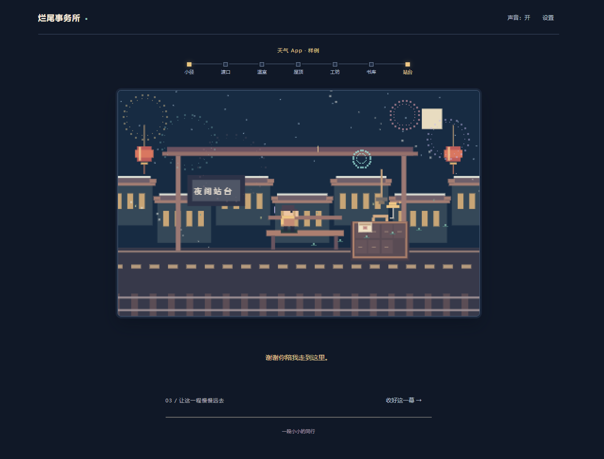
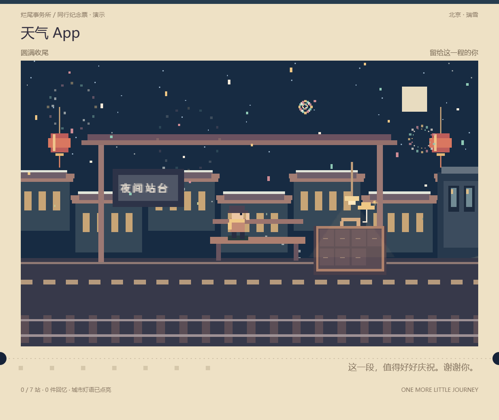
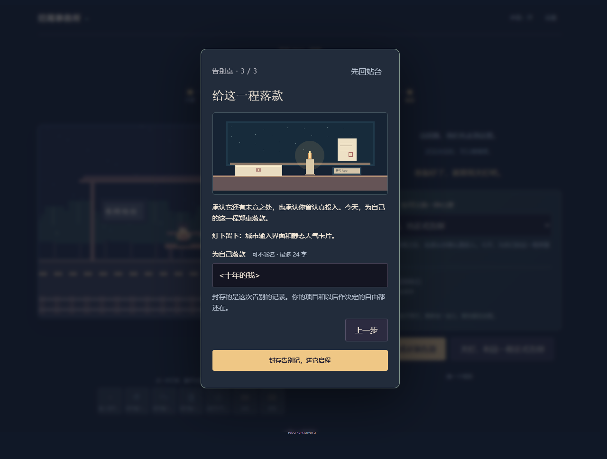

# 烂尾事务所 · 再走一小段

一个关于和项目好好告别的像素推箱游戏。带上项目资料出发，走过七站：有 GitHub 提交时，前五站会把实际更新变成日记线索；第六站收下成果、回忆或仍惦记的事，由你决定珍藏还是带走；第七站与项目伙伴告别，关灯后会让实际收好的旅途物件逐格回亮，再让随项目类型变化的道具亮起。没有提交记录时不会编造项目经历。

陪伴多年的项目，也可以圆满收尾。出发前可选择「未完成，也正式告别」「圆满收尾」「暂时休息」「交给后来的人」，或「暂不定义，先回看」；书库、告别字幕和导出的回忆册会回应你的选择。到了站台仍能改主意，关卡进度、留言和书签会保留。带走纪念页可以只是带走收获，便签也可以是祝福，不必成为新的任务。

出发前分为「项目原件 → 同行心意 → 目的地」三个页面。原件页可翻看所选 README、源码或提交差异，并添加最多 4 张截图；结果页分为纪念票、回忆册、项目原件。图片留在当前页面，不发给分析服务；下载回忆册会保存图片和所选文字原件。

天气 App 的「输入城市」行李标签现在可以点开体验：输入北京或 New York，沿途换成灯笼屋檐或大都会天际线，还可选择瑞雪、圣诞和万圣节场景。其他城市使用通用夜景；这是本地场景风格，不查询实时天气。找到街角的灯可以获得「同行灯」，同时照亮两位伙伴能走的下一格。最后是约 9 秒的近景交接、登车、镜头拉远与烟花；减少动态直接呈现终态。

## 先试玩

需要较短的完整体验时，选择样例后，在“今天，陪它走多远？”选 **一站同行**：实际走完第一关 → 翻看回忆、整理一件原件 → 到站 → 亲手完成正式告别 → 保存纪念。结果会如实显示 `1 / 7 站 · 一站同行`。默认仍是七站旅程；途中临时退出会另标提前到站。

现场接手请看 [协作者交接](COLLABORATOR-HANDOFF.md)，包含启动步骤、演示路径与留给 Kiro 的具体增量任务。需求和设计位于 [.kiro/specs/one-stop-farewell](.kiro/specs/one-stop-farewell/requirements.md)，实际工具使用记录见 [KIRO-LOG.md](KIRO-LOG.md)。

[打开公网试玩版](https://mtmt0111.github.io/unfinished-office-play/)。这是面向玩家的静态版本，包含样例、浏览器支持的本地材料选择、手动整理和完整游戏。要用本机 GitHub 登录态读取仓库或调用 API，请运行下面的完整版本。

## 游戏画面

<p align="center"></p>
<p align="center"></p>
<p align="center"></p>
<p align="center"></p>

截图使用内置天气 App 样例；回忆页里的个人补记是演示输入，不代表真实仓库提交或项目经历。

## 在电脑运行完整版本

需要 Node.js 24。若要导入 GitHub 仓库，还需安装 GitHub CLI 并登录。首次运行时，在项目目录打开 PowerShell：

```powershell
npm ci
npm start
```

然后打开 <http://127.0.0.1:4188/>。Windows 也可以在安装依赖后双击 `启动事务所.cmd`。macOS 或 Linux 用户在克隆下来的项目目录执行相同的 `npm ci`、`npm start` 命令即可。

导入项目可选择本地文件夹、搜索或粘贴 GitHub 仓库，也可手动填写。GitHub 读取复用本机 `gh` 登录权限；API 分析默认使用 DeepSeek，也支持 OpenAI 兼容接口。API 分析是可选步骤，整理结果需要自己核对。要改代码时，另开终端运行 `npm run dev`，访问 <http://127.0.0.1:5173/>；本地 API 服务需同时运行。

## 玩法与项目边界

地图以夜路探索的方式展开：远处的收藏物先是一点微光，走近才看清；残门、渡口、温室、屋顶、工坊、书库与站台各有自己的景物。发现物件、打开桥或点灯后，环境和短句会回应。到站条件收在“看看留下的记号”里，详细操作可“问问伙伴”；需要具体下一步时点“请伙伴指路”。设置中的落脚提示默认关闭，可以随时开启。场景是告别旅程的象征，项目事实仍以确认资料和原件为准。

- 方向键或 WASD 移动；`X` 切换角色，`Z` 撤销，`Y` 重做。手机可用屏幕方向键。
- 每关的机关和行李对应项目资料；已读取的 GitHub 提交可按日期、说明和文件变化回看。没有证据的经历会留白，不会编造成就。
- 这是轻量项目档案整理，不是完整代码审计：不会运行、修改或删除导入的项目，也不会验证项目是否真的构建成功。
- 只有点击分析后，已勾选的文字材料才会发送到所配置的 API。文件内容和页面填写的密钥不会写入浏览器存储；请先检查材料中是否含有不打算发送的内容。
- 关卡通关只代表这段游戏旅程结束，不代表项目完工。刷新会清除当前旅程和未下载的个人回忆。

## 到站后的心意

从 GitHub 导入后，展开“回忆从这里开始”，可以选择一个截止日期，翻找那一天以前默认分支上的最近 40 条提交。已经勾选的更新会保留，最多选五次，让不同年份的项目片段一起同行。

前五站的回忆页新增“亲手整理一件”：选择提交中真实改过的文件，切换改动前后片段，把它珍藏、交给后来的人，或暂存书架。每站最多一件，可改选或留白；下面的个人补记会与它一起保存。珍藏的文件留在行李里，交接的文件随列车出发，暂存的文件留在站台书架。样例和本地项目的第一站也可以整理带来的原文，不会伪造 Git 历史。

到站后的回忆册可以回看、改选遗物，并下载 Markdown 项目交接单，包含文件路径、提交日期、完整 SHA、原始链接和你的补记。选择仅影响旅程，不修改 GitHub 文件或事项；交接单可自行核对后放回原仓库。

到站后可以选择未完成也正式告别、圆满收尾、暂时休息、交给后来的人，或暂不定义。九秒告别从近景缓缓拉远：分别以纸灯（完成正式告别仪式后）、烟花、暖窗、接力灯火或安静星空回应这份心意。沿途找到的同行灯会在最后一幕照亮站台。

站台的“留一封短信给它”支持 120 字，也可以带上出发前写的心意或留白。短信会作为信封收入行李，并完整写入纪念票与离线回忆册；提前到站也能保存。“重看告别”只重播最后一幕，“收好这一幕”可随时跳过，均保留进度、回忆、城市和短信。减少动画模式直接展示静态纪念。短信与旅程一样暂存在当前页面，刷新前请下载保存。

## 参与共创

源码仓库为私有仓库。获邀后可克隆并创建分支：

```powershell
git clone https://github.com/MTMT0111/unfinished-office.git
cd unfinished-office
npm ci
npm test
npm run build
```

修改后请先运行 `npm test` 和 `npm run build`，再提交分支并发起 Pull Request。`npm test` 使用 Node.js 内置测试运行器；浏览器端到端脚本依赖本机 Playwright 与 Edge，具体环境见 `tests/` 脚本。

`node tests/experience.mjs` 对运行中的本地 Demo 检查原件与图片、城市切换、彩蛋能力、连续帧布局稳定性、告别镜头和离线导出。`tests/browser.mjs` 还读取开发模块来检查动画，需运行 Vite，并将 `APP_URL` 设为 `http://127.0.0.1:5173`。`tests/play-settings.mjs` 覆盖七站搬运与既有回忆交互。

`node tests/relics-browser.mjs` 使用本地 GitHub 响应样例检查跨年选择、空记录/断网恢复、遗物前后片段与三种去处、回看改选，以及实际交接单和回忆册下载；无需访问私人仓库或调用模型。

目前 **Yongzhi Li（[@chnoorlee](https://github.com/chnoorlee)）** 已接受邀请，并以写入权限参与私有源码共创。

## 开发与设计

```powershell
npm test
npm run build
```

`npm run build` 生成 `dist/` 和可离线双击的 `打开试玩.html`。主要代码位于 `src/`，本地 GitHub/API 服务在 `server.mjs`，关卡与故事设计见 [DESIGN-JOURNEY.md](DESIGN-JOURNEY.md)，原创素材说明见 [ASSETS.md](ASSETS.md)。运行环境或端口可通过 `UNFINISHED_OFFICE_PORT` 调整。

**比赛与署名：**2026-10-21 用户确认沿用现有项目，先完成部分功能，现场由协作者继续完善。本轮基础实现与交接材料由 Codex 完成；实际 Kiro 调用尚未成功，不能计作 Kiro 开发成果。后续按现场要求记录 Kiro 的具体任务、人工判断和真实提交。代码提交保留实际作者与共同作者信息；无需在项目中保存账户邮箱等个人信息。

## 亲手完成正式告别

七站同行与真实遗物整理之后，站台的「亲手完成这场告别」会打开三幕告别桌：折好资料中仍未完成的一页；为带来的真实文件、已确认成果或自己的心意点灯；最后选择署名或匿名，封存告别记，再送伙伴启程。未取得的资料留白，象征灯明确标明用途。提前到站也可以举行仪式，不以解谜成绩评价这段投入。

「告别记」是独立纪念页面，完整保存在纪念票 PNG 与离线回忆册 HTML 中。它保存封存时的内容，不会因为后来修改回忆而改写。中途退出或按 Escape 可以回站台，当前页面内保留仪式草稿；也可直接关灯。本次旅程仍不跨刷新保存，请在离开前下载纪念。

参考与设计取舍见 [设计说明](DESIGN-JOURNEY.md)。验证命令：`npm test`、`npm run build`、`node tests/ritual-browser.mjs`（先运行本地服务）。


